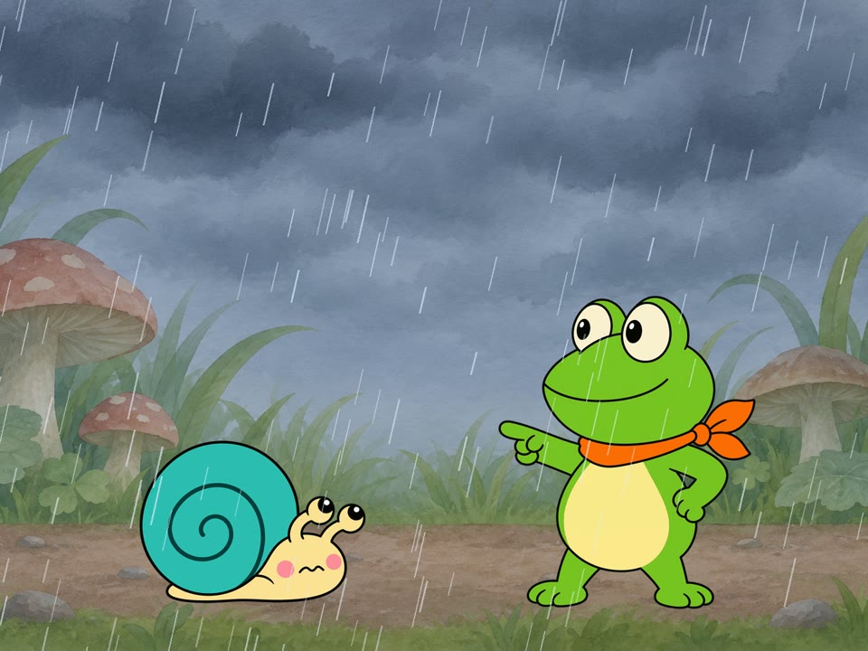

# dula-craft

English | [简体中文](README.zh-CN.md)

Let an AI agent guide you through making a flat-color animated short: from a one-line idea to character designs, drawings, lip sync, voices and a finished video.

Works with **Claude Code, Codex, Kimi Code and Qoder** on Windows, macOS and Linux.

[](docs/demo.mp4)

*Click to watch the 15-second demo. An AI agent made it using only this repository. [See how](docs/tutorial.md).*

## Get started in three steps

**1. Install.** You need git and Python 3.9 or newer.

On Windows, in PowerShell:

```powershell
irm https://raw.githubusercontent.com/orange9angel/dula-craft/main/install.ps1 | iex
```

On macOS or Linux, in a terminal:

```bash
curl -fsSL https://raw.githubusercontent.com/orange9angel/dula-craft/main/install.sh | bash
```

**2. Restart** your AI tool.

**3. Say:**

> Make me an animated short

Your agent checks your setup, asks three questions and gets to work. It talks to you in your language.

## Documentation

| I want to... | Read |
|---|---|
| Make my first film, step by step | [Quickstart](docs/quickstart.md) |
| See how the demo film was made | [Tutorial](docs/tutorial.md) |
| Set up images and voices | [Configuration](docs/configuration.md) |
| Fix an error | [FAQ](docs/faq.md) |
| Know who owns my film and whether I can sell it | [Licensing and rights](docs/licenses.md) |
| Contribute | [Contributing](CONTRIBUTING.md) |

## What's included

| Skill | What it does |
|---|---|
| `dula-start` | The way in: checks your setup and shapes your idea |
| `dula-flat-cel` | The main workflow: character designs, drawings, lip sync, mix, render and automatic checks |
| `dula-voice` | Voices, ambience and sound effects, using your own key (optional) |
| `dula-subtitles` | Dual-language subtitles with a color for each speaker |
| `dula-title-card` | Ink-style title cards, made entirely in code |

## What does it cost?

This project is free. You only pay for third-party services you choose to use, on your own accounts.

| Step | Free option | Paid option |
|---|---|---|
| Images | Make them with any tool you have and drop them in | Codex CLI does it automatically, using your ChatGPT plan |
| Voices | Record your own | Volcano Engine Seed-Audio, billed by usage |
| Assembly, subtitles, title cards | Everything runs on your computer | None |

## Update and uninstall

Run the install command again to update. See [Configuration](docs/configuration.md#uninstall) to uninstall.

## Privacy

There is no telemetry, and this project collects nothing. Your prompts, reference images and reference audio go to an outside service only when you choose to use that service. Your voice key stays on your computer in `~/.dula-craft/config.env`.

## Get help

| I want to... | Go to |
|---|---|
| Ask a question, share an idea or show my film | [Discussions](https://github.com/orange9angel/dula-craft/discussions) |
| Report an error or suggest an improvement | [Issues](https://github.com/orange9angel/dula-craft/issues/new/choose) |
| Report a security problem privately | [Security](SECURITY.md) |

You need a free GitHub account to post, and everything except security reports is public, so never post a key. You're welcome to write in Chinese or English. This is a spare-time project, so replies may take a while.

## License

Everything here is under the [MIT License](LICENSE). The films you make are yours. See [Licensing and rights](docs/licenses.md).
