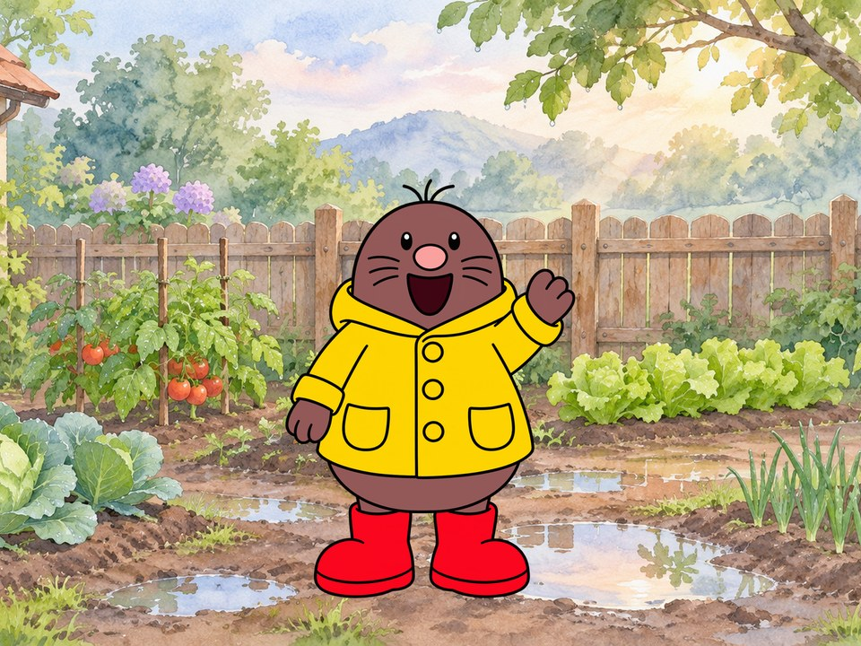

# dula-craft

[English](README.md) | 简体中文

让 AI 带你做一支平涂线条动画短片：从一句话故事，到角色设定、动作画、嘴型、配音和成片。

支持 **Claude Code、Codex、Kimi Code**，Windows、macOS、Linux 都能用。



## 三步开始

**1. 安装**（已装好 git 和 Python 3.9+）

Windows，在 PowerShell 里运行：

```powershell
irm https://raw.githubusercontent.com/orange9angel/dula-craft/main/install.ps1 | iex
```

macOS / Linux，在终端里运行：

```bash
curl -fsSL https://raw.githubusercontent.com/orange9angel/dula-craft/main/install.sh | bash
```

**2. 重新打开**你的 AI 工具。

**3. 对它说：**

> 帮我做一支动画短片

它会检查环境，问你三个问题，然后开工。

## 文档

| 我想…… | 看这里 |
|---|---|
| 一步一步做出第一支片子 | [快速开始](docs/zh-CN/quickstart.md) |
| 配置出图和配音 | [配置说明](docs/zh-CN/configuration.md) |
| 解决报错和常见问题 | [常见问题](docs/zh-CN/faq.md) |
| 了解能不能商用、作品归谁 | [版权和协议](docs/zh-CN/licenses.md) |
| 贡献内容 | [贡献规则](CONTRIBUTING.md) |

## 里面有什么

| Skill | 做什么 |
|---|---|
| `dula-start` | 入口：检查环境、接住创意 |
| `dula-flat-cel` | 核心流程：设定图 → 动作画 → 嘴型 → 混音 → 成片 → 自动检查 |
| `dula-voice` | 配音、环境音和音效（用你自己的火山密钥，可选） |
| `dula-subtitles` | 双语字幕，角色自动分色 |
| `dula-title-card` | 水墨标题字卡，纯代码生成 |

## 要花钱吗

本项目免费。花钱的只有你自己选用的第三方服务，都走你自己的账号：

| 环节 | 不花额外的钱 | 付费或订阅 |
|---|---|---|
| 画面 | 用你已有的出图工具，手动放回 | Codex CLI 全自动，消耗 ChatGPT 订阅额度 |
| 配音 | 自己录 | 火山 Seed-Audio，按用量计费 |
| 合成、字幕、字卡 | 全部本地运行 | 无 |

## 更新和卸载

重新运行安装命令就是更新。卸载命令见[配置说明](docs/zh-CN/configuration.md#卸载)。

## 隐私

没有遥测，也不上传数据。只有你选用出图或配音时，提示词、参考图和参考音频才会发给对应的服务。
配音密钥只存在你电脑上的 `~/.dula-craft/config.env`。

## 协议

全部内容采用 [MIT 协议](LICENSE)。用它做的作品归你，详见[版权和协议](docs/zh-CN/licenses.md)。

